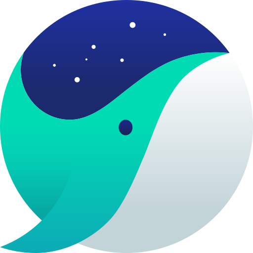

<div align="center">


# 넛지브레이크 (NUDGE)

### 방해는 멀리, 집중은 가까이.

자꾸 들어가게 되는 사이트를 막아,
해야 할 일에 집중하도록 도와주는 브라우저 확장 프로그램입니다.

Chrome과 Firefox를 지원하며,
NAVER Whale도 지원합니다.

<br>

<p>


</p>

<p>


</p>

<p>

<a href="https://github.com/LUXERET-co/NUDGE/issues">

</a>

<a href="https://github.com/LUXERET-co/NUDGE/pulls">

</a>

<a href="https://github.com/LUXERET-co/NUDGE/stargazers">

</a>

</p>

</div>

---

# ✨ 주요 기능

## 🚫 사이트 차단

등록한 사이트에 접속하면 차단 화면이 표시됩니다.

- 사이트 주소를 직접 등록할 수 있습니다.
- 미러 주소도 함께 차단합니다.

예:

```
youtu.be → youtube.com
```

---

## 🔍 검색어 차단

검색창에 등록한 사이트나 키워드를 입력하면

검색 결과가 열리기 전에 차단합니다.

---

## 🇰🇷 한글 사이트 이름 인식

사이트 이름을 정확히 몰라도 괜찮습니다.

다양한 표현을 자동으로 인식합니다.

예:

- 유튜브
- 유투브
- 인스타
- 인스타그램

---

## 🔒 엄격 모드

더 강한 집중 환경이 필요하다면 사용할 수 있습니다.

제공 기능:

- 뒤로가기 차단
- 잠금 해제 번호 강화

---

## ⏳ 임시 잠금 해제

정말 필요한 경우에만 잠시 사용할 수 있습니다.

숫자를 역순으로 입력하는 미니게임을 통과하면
원하는 시간 동안 사이트 접근을 허용합니다.

지원 시간:

- 3분
- 5분
- 10분
- 30분

---

## 📂 차단 목록 관리

차단 목록을 카테고리별로 관리할 수 있습니다.

- 🎮 엔터테인먼트
- 💬 커뮤니티
- 🛒 쇼핑·포털
- 📌 기타

---

## ⚡ 프리셋 추가

자주 차단하는 사이트는 검색 후 바로 추가할 수 있습니다.

---

# 📦 기본 제공 사이트

기본 프리셋:

- YouTube
- Instagram
- 나무위키
- Facebook
- X (Twitter)
- TikTok
- Netflix
- Twitch
- Reddit
- 디시인사이드
- 에펨코리아
- 뽐뿌
- 쿠팡
- 네이버
- 카카오

프리셋에 없는 사이트와 키워드도 직접 추가할 수 있습니다.

---

# 🚀 설치 방법

---

##  Google Chrome (심사중)

[](#)

---

##  Mozilla Firefox (심사중)

[](#)

---

##  NAVER Whale (심사중)

[](#)

---

# 📖 사용 방법

1. 확장 프로그램 아이콘을 클릭합니다.
2. 차단 기능을 켭니다.
3. 차단할 사이트 또는 키워드를 추가합니다.
4. 차단 화면에서 필요한 경우 잠시 잠금을 해제합니다.
5. 더 강한 제한이 필요하면 엄격 모드를 사용합니다.

---

# 📂 프로젝트 구조

```text
.
├── manifest.json       # Manifest V3 설정
├── background.js       # 차단 로직 및 페이지 감지
├── popup.html
├── popup.js            # 설정 화면
├── block.html
├── block.js            # 차단 화면 및 잠금 해제
├── icons/              # 확장 프로그램 아이콘
└── logo.png
```

---

# 🛡️ 권한 안내

| 권한 | 사용 목적 |
|---|---|
| `tabs` | 차단 페이지로 이동하기 위해 사용합니다. |
| `storage` | 차단 목록과 설정을 저장합니다. |
| `webNavigation` | 페이지 이동을 감지하고 차단 여부를 확인합니다. |

> 넛지브레이크는 개인정보와 방문 기록을 외부 서버로 전송하지 않습니다.

모든 데이터는 사용자의 브라우저 내부에 저장됩니다.

---

# 🤝 기여하기

버그 제보와 기능 제안을 환영합니다.

참여 방법:

1. 저장소 Fork
2. 새로운 Branch 생성
3. 변경 사항 작성
4. Pull Request 생성

도움이 필요한 경우:

- 🐞 [Bug Report](https://github.com/LUXERET-co/NUDGE/issues)
- 💡 [Feature Request](https://github.com/LUXERET-co/NUDGE/issues)
- 🔀 [Pull Request](https://github.com/LUXERET-co/NUDGE/pulls)

---

# 💖 후원하기

넛지브레이크가 도움이 되었다면
프로젝트를 응원해 주세요.

<p align="center">

<a href="https://litt.ly/luxeret">


</a>

</p>

---

# 📜 라이선스

이 프로젝트는  
**CC BY-NC 4.0 License**를 따릅니다.

허용:

- ✅ 수정
- ✅ 개인 사용
- ✅ 원작자 표시 후 재배포

제한:

- ❌ 상업적 이용
- ❌ 판매 목적 배포

---

# 🏢 사업자 정보

| 항목 | 내용 |
|---|---|
| 상호명 | 룩세렛 |
| 대표자 | 김태준 |
| 사업자등록번호 | 802-68-00634 |
| 통신판매업신고 | 제2026-화성동탄-0247 |
| 주소 | 경기도 화성시 10용사로 344 102-B95호 |

---

<div align="center">

## ⭐ 방해는 멀리, 집중은 가까이.

집중하고 싶은 순간마다  
**넛지브레이크**가 함께합니다.

<br>

<a href="https://github.com/LUXERET-co/NUDGE/stargazers">


</a>

<a href="https://litt.ly/luxeret">


</a>

<br><br>

Made with ❤️ by **룩세렛**

</div>
